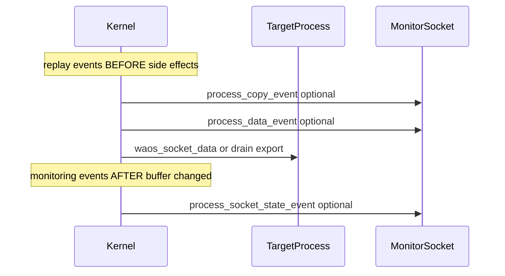
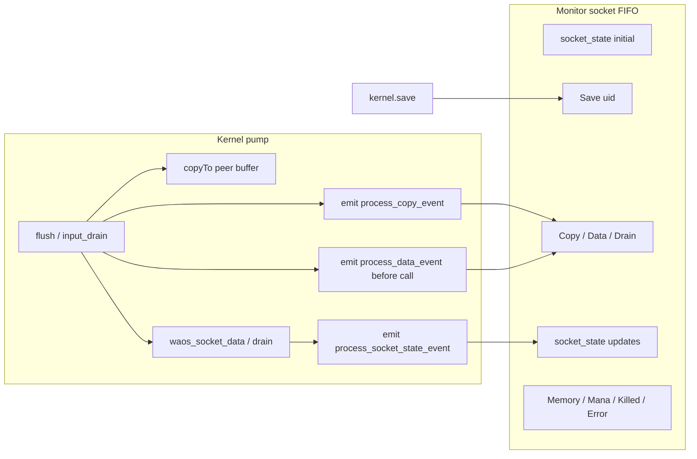

# ts-kernel

`ts-kernel` is a minimal WA-OS kernel implementation in TypeScript.
Its main goal is to provide only the essential runtime primitives:

- process list and `process_id` allocation
- message transport through sockets
- process lifecycle and monitoring

The design is intentionally minimal because WA-OS needs equivalent kernels in multiple environments.
This implementation targets Node.js and browsers, but the same contract should also be implementable in runtimes such as WAVM, Wasmer, or WASMEdge.

## Why this kernel stays minimal

This kernel is expected to be hidden behind a first process that acts as a shield.
Other processes should not communicate with the kernel directly.

The idea is:

- keep kernel responsibilities small, deterministic, and portable
- move higher-level features to the shield process and other user processes
- keep cross-runtime behavior predictable by minimizing kernel surface area
- keep deterministic process recording and replay at the kernel level (not in process-shield or other proxies)

## Core building blocks

- `Kernel`: owns the `processes` table and process lifecycle operations
- `ModuleProcess`: executes WASM modules and exposes module sockets
- `LocalProcess`: local non-WASM process, useful for tests and adapters
- `Process`: shared interface for lifecycle, socket wiring, and monitoring

## Why Message Passing and Sockets?

A fundamental design choice in WA-OS is using sockets instead of direct WASM module function calls. This provides three critical guarantees:

- **Strict Isolation & Sandboxing:** A process cannot connect to or monitor anything without invoking the kernel. This allows us to easily inject a "process shield" (similar to `kernel-shield`) in front of an untrusted process to create a perfectly safe sandbox. This isolation is mandatory for competitive bots, smart contracts, and user-extensible applications.
- **Network Transparency:** Binary message passing over sockets translates trivially to network streams, making it vastly easier to distribute processes across a cluster compared to proxying direct function calls.
- **Native Backpressure:** Sockets provide a natural boundary for flow control (unlike synchronous function calls).

## Message Transport & Buffers

Communication between processes is established by forming directed links via `bind`/`unbind`.

At its core, transport is strictly binary. When a producer flushes data, its output buffer is directly copied to the consumer's input buffer (`outputBuffer.copyTo(inputBuffer)`). Typed messages are encoded and decoded on top of this binary stream.

**Flow Control and Backpressure:**
Backpressure is naturally enforced at the binary-buffer level. It is driven by writable/readable buffer states and explicit callbacks:
- In `LocalProcess`: `flushCallback` and `drainCallback`.
- In `ModuleProcess` (WASM): `waos_socket_flush` and `waos_socket_input_drain`.

If a consumer's input buffer is full, the producer's output buffer will fill up, and the producer must wait for the consumer to drain the data.

**Why Circular Buffers?**
Serialization and deserialization happen directly into and out of circular buffers (`LocalCircularBuffer`, `FlatLocalCircularBufferWriter`, `FlatLocalCircularBufferReader`). 
Circular buffers provide predictable, bounded memory behavior. Because processes must manage their own memory and buffers, this explicit control over resource usage is crucial. It aligns perfectly with future requirements for charging and measurement (e.g., tracking mana/gas limits) in competitive bots and smart-contract-like workloads.

## Networking and Clusters

The binary chunk flow and explicit buffer boundaries perfectly fit network fragmentation and asynchronous delivery.

When building clustered or distributed kernel adapters, the binary stream can be easily chunked, sent over TCP/WebSocket, and reassembled on the other side. The process abstraction remains completely unbroken, as the processes are already designed to handle fragmented binary streams and asynchronous backpressure.

## Lifecycle model: alive + tombstone

Each process has `isAlive`.

- `isAlive = true`: active process
- `isAlive = false`: dead process tombstone

After `kill`, a process is not immediately removed from `Kernel.processes` if someone still monitors it.
A process slot is released only when both conditions are true:

- `isAlive === false`
- `monitors.length === 0`

Kernel-side release is centralized in `releaseProcessIfDeadAndUnmonitored(processId)`.

## Monitoring model: incoming and outgoing relations

Each process tracks two sets:

- `monitors` (incoming): who is monitoring this process
- `monitoredProcesses` (outgoing): which processes this process is monitoring

Incoming monitor entries are managed explicitly via:

- `addMonitor(monitorProcess, socketId)`
- `removeMonitor(monitorProcess, socketId)`

`monitor(...)` and `demonitor(...)` keep both sides of the relation consistent.

Each monitor relation also carries a `monitor_config` with a `flags` bitmask. Flags select which `process_event` types the kernel emits to the monitor socket. See **Process recording and replay** below.

## Process recording and replay

Deterministic post-mortem debugging requires recording at the **kernel pump layer** — the moment bytes are copied between socket buffers and when `data`/`drain` callbacks run on a process. Proxy layers (such as process-shield) cannot provide faithful replay once a scheduler decouples queueing from delivery.

### Monitoring vs recording

Not every observer needs a full replay trace. Flags split into **monitoring** (live visualization, liveness) and **recording** (deterministic replay).

| Preset | Flags | Use |
|--------|-------|-----|
| `LIVENESS` | `KILLED \| ERROR` | PID repository, tombstone contract |
| `MONITORING` | `INITIAL_BUFFER_STATE \| INITIAL_BUFFER_DATA \| BUFFER_STATE \| BUFFER_DATA \| COPY \| MEMORY \| MANA \| KILLED \| ERROR` | Live observability, circular-buffer visualization |
| `RECORDING` | `COPY \| COPY_PAYLOAD \| DATA \| DRAIN \| SAVE \| MANA \| BIND \| KILLED \| ERROR` | Full trace for debug replay |

- **`socket_state`** events are monitoring-only; replay uses `save` + `Copy` / `Data` / `Drain` (+ trailing payload).
- **`COPY`** — transfer metadata (`amount`); useful for monitoring without byte capture.
- **`COPY_PAYLOAD`** — trailing payload with copied bytes; required for replay.
- **`INITIAL_BUFFER_*`** — buffer snapshot when observation starts.
- **`BUFFER_*`** — buffer updates after `Copy` / `Data` / `Drain` when the process changed buffer offsets.

Each monitor relation (target, monitor process, monitor socket) has its own flag set.

Monitor events are sent as length-prefixed messages on the **flat** wire (`flat_socket_message_channel` / `FlatSocketMessageChannel`: `u32` type, `encoded_size`, sentinel). This is independent of USER-socket registry `dataFormat` (compressed/flat/key) used for Copy RPC payloads. The serialized struct is the message header; large binary data is appended as a **trailing message payload** after the header (via `begin_send` / `commit_send`), not embedded in the struct. This applies to `process_copy_event` (with `COPY_PAYLOAD`) and `process_socket_state_event` (with `INITIAL_BUFFER_DATA` / `BUFFER_DATA`).

### Recording model: snapshot + FIFO I/O

A recording session combines periodic memory snapshots with a FIFO stream of I/O events on the monitor socket:

1. `monitor(target, recorder, socket, config)` — start observing the target with the desired flags.
2. `save(target)` — anchor: returns `save_result { snapshot_uid, memory, mana_used, mana_limit }` and emits `process_save_event` to monitors with the `SAVE` flag. WASM linear memory includes socket circular-buffer data and read/write offsets (`ModuleCircularBuffer` lives inside linear memory). Host-side mana is included separately because it is not part of linear memory.
3. Runtime — kernel emits replay events (`Copy` / `Data` / `Drain`, per config) **before** the corresponding process side effect, and monitoring events (`socket_state`, per config) **after** buffer state changes.
4. Optional later `save(target)` calls — new snapshot anchors with incrementing `snapshot_uid` (per target process: 1, 2, 3…).
5. On death — `process_killed_event` or `process_error_event` if enabled.

**Replay** (conceptual): `resurect(code, memory_from_snapshot_uid)` plus replay of subsequent events in FIFO order from the monitor socket. No global sequence numbers are required — the monitor socket is an ordered pipe.

**bind/unbind topology** is recorded with dedicated `process_bind_event` / `process_unbind_event` when the `BIND` flag is set. Host-side `kernel.bind` / `unbind` often leave no RPC footprint on the target’s kernel-API socket, so inferring topology from Copy/Data/Drain alone is incomplete. Kernel RPC traffic on that socket is still captured as ordinary I/O when Copy/Data/Drain flags are enabled.

### Inspection APIs (bindings + registries)

Used by the recorder (via kernel-shield) to capture decode metadata for dumps:

| Method | Returns | Notes |
|--------|---------|--------|
| `list_socket_bindings(process_id)` | `socket_binding[]` | From `socketConnections`. Each row is relative to that process (`OUT` = `connectedTo`, `IN` = `connectedFrom`, same peer both ways → `BOTH`). Missing process → throw. |
| `get_rpc_description(process_id, socket_id)` | `binary` | `ModuleProcess`: soft `readRawRpcDescriptionOrEmpty` (copy out of WASM memory; failures → empty, **no** process kill). `LocalProcess`: `serializeTypeRegistry` of `getRpcDescription(socket)`, or empty if unset. Missing process → throw. |

### Debug replay model

Replay runs an **isolated WASM process** without the kernel, binds, or peers. Recorded IN/OUT on sockets replaces the external world.

- **Copy → Data/Drain order** — the kernel copies bytes first, then invokes `waos_socket_data` / `waos_socket_output_drain`. Replay must respect this FIFO order.
- **OUT assertion** — `Copy` with direction `OUT` and `COPY_PAYLOAD` is a debug assertion: replay compares emitted bytes with the recording. A mismatch indicates a bug, not a soft failure.
- **Mana** — `waos_use_mana` inside WASM is deterministic and needs no event. External `measure_mana` / `set_mana_limit` affect host-side state and emit `MANA` events; `save_result` carries `mana_used` / `mana_limit` at snapshot time.
- **`save`** is also used outside replay (resume, inspection).
- **WASI** (e.g. `printf`) is ignored for now — it does not change WASM determinism.

### Monitor config flags

Configuration is passed as `monitor_config { flags: uint32 }` — a bitwise OR of `monitor_flag` values (plain enum constants, not C++ bitfields, because serialization does not support bitfields).

| Flag | Purpose |
|------|---------|
| `COPY` | `process_copy_event` metadata (`amount`) |
| `COPY_PAYLOAD` | Trailing payload on `process_copy_event` |
| `DATA` | `process_data_event` **before** `handleData` |
| `DRAIN` | `process_drain_event` **before** `handleDrain` |
| `INITIAL_BUFFER_STATE` | `process_socket_state_event` at monitor start (offsets only) |
| `INITIAL_BUFFER_DATA` | Same + trailing payload with buffer contents |
| `BUFFER_STATE` | `process_socket_state_event` after buffer change (offsets only) |
| `BUFFER_DATA` | Same + trailing payload after buffer change |
| `SAVE` | `process_save_event` on each `save` |
| `MANA` | `process_measure_mana_event` / `process_set_mana_limit_event` |
| `BIND` | `process_bind_event` / `process_unbind_event` after successful `bind` / `unbind` |
| `MEMORY` | `process_memory_event` (linear memory size) |
| `KILLED` / `ERROR` | Death notifications |

### Event semantics

All events inherit from `process_event` with field `process` = monitored target id.

**Direction** is relative to the **monitored process**:

- `OUT` — output buffer of the socket (data leaving the process on flush)
- `IN` — input buffer of the socket (data entering the process on drain)

For `process_socket_state_event`, `direction` selects which circular buffer is described (`IN` = input buffer, `OUT` = output buffer). Readable byte count can be derived from `read_offset`, `write_offset`, and `buffer_size`.

| Event | Flags | When emitted | Fields | Notes |
|-------|-------|--------------|--------|-------|
| `process_socket_state_event` | `INITIAL_BUFFER_*` | On `monitor()` | `socket`, `direction`, `buffer_size`, `read_offset`, `write_offset` | Monitoring only; optional trailing payload with `*_BUFFER_DATA` |
| `process_socket_state_event` | `BUFFER_*` | After `Copy` / `Data` / `Drain` if buffer changed | same | Emitted **after** the operation; only when offsets/capacity changed |
| `process_copy_event` | `COPY` / payload: `COPY_PAYLOAD` | Each byte pump | `socket`, `direction`, `amount` | With `COPY_PAYLOAD`, kernel appends copied bytes as trailing payload |
| `process_data_event` | `DATA` | **Before** `handleData` / `waos_socket_data` | `socket`, `direction` | Replay event; separate from `Copy` for scheduler correctness |
| `process_drain_event` | `DRAIN` | **Before** `handleDrain` / `waos_socket_output_drain` | `socket`, `direction` | Replay event; pump support pending (see below) |
| `process_measure_mana_event` | `MANA` | After `measure_mana` | `new_mana` | External mana injection |
| `process_set_mana_limit_event` | `MANA` | After `set_mana_limit` | `mana_limit` | External mana limit change |
| `process_save_event` | `SAVE` | Each `kernel.save(target)` | `snapshot_uid` | Log anchor; same uid as in `save_result` |
| `process_memory_event` | `MEMORY` | Monitor start + each WASM memory grow | `size` | Linear memory size in bytes |
| `process_bind_event` | `BIND` | After successful `kernel.bind` | `socket`, `peer_process`, `peer_socket`, `direction` | Emitted to monitors of **both** sides; fields relative to each monitored process (`direction` inverted for the peer: `IN`↔`OUT`, `BOTH` unchanged). Before first related `Copy`. Await monitor buffer space (same backpressure model as `save`) |
| `process_unbind_event` | `BIND` | After successful `kernel.unbind` | same | Same emit rules as bind |
| `process_killed_event` | `KILLED` | `kill()` without error | — | Existing type |
| `process_error_event` | `ERROR` | `kill(error)` | `error` | Existing type |

**Event ordering** for one pump operation: replay events (`Copy`, `Data`, `Drain`) are emitted **before** the process callback; `process_socket_state_event` is emitted **after** the operation when buffer offsets changed and `BUFFER_*` flags are set.

**Recording backpressure:** bytes in a `process_copy_event` (header + optional trailing payload) are limited by `min(source readable, destination writable, monitor socket space for the frame)`. Events must not be silently dropped — a full monitor buffer blocks the pump (`amount = 0`) to preserve replay determinism. Monitor input buffers are **not** auto-grown by the kernel.

**Save backpressure:** `kernel.save(target)` awaits delivery of `process_save_event` to all monitors with the `SAVE` flag. If a monitor input buffer is full, `save()` waits until the recorder consumes data (same backpressure model as the pump, but async await instead of stall). Hard errors (missing process/socket) still throw; buffer-full is not an error.

### Drain

`process_drain_event` and `DRAIN` flag are emitted **before** deferred `handleDrain` when the producer output buffer is at or below `drainEventThreshold` after consumer `handleData`. `process_socket_state_event` follows when buffer offsets changed.

## Kill behavior

When a process is killed:

1. It is marked dead (`isAlive = false`)
2. All socket bindings are disconnected immediately (including peer-side references)
3. All outgoing monitor relations are removed (the dead process stops monitoring others)
4. Incoming monitors receive a death notification:
  - `process_killed_event`
  - `process_error_event` (when kill carries an error)
5. Kernel tries to release the slot, but only if incoming monitor count is already zero

Important: incoming monitors are not automatically removed after notification.
Each monitoring process must call `demonitor(...)` explicitly.

## Why tombstones are required

Tombstones protect direct process-to-process communication from `process_id` reuse races.

Consider this scenario:

1. A source process needs to talk directly to a target process
2. It gets target `process_id` from a process repository
3. The repository must guarantee that this `process_id` referred to a live target, so the repository monitors registered processes
4. Before giving out the `process_id`, the repository asks kernel to make the source process monitor the same target
5. The source process can now communicate directly and trust target liveness via monitor events

Now the race:

- target process dies
- death notification to observers may arrive slightly later
- if `process_id` were released immediately, another process could take the same ID
- source process could accidentally send traffic to the wrong process

Tombstone behavior closes this race window:

- dead process keeps its slot while still monitored
- no new valid direct communication can be attached to that dead process
- repository and source process receive death notification, stop using that `process_id`, and perform internal cleanup
- only after all relevant parties call `demonitor(...)` can the slot be recycled

This gives observers time to converge on the new state before ID reuse is allowed.

## Contract for direct communication

If a process communicates directly with another process, it should:

- monitor target liveness before relying on its `process_id`
- stop using the target ID immediately after death notification
- call `demonitor(...)` after handling cleanup

This contract is what makes tombstones effective and keeps ID reuse safe.
